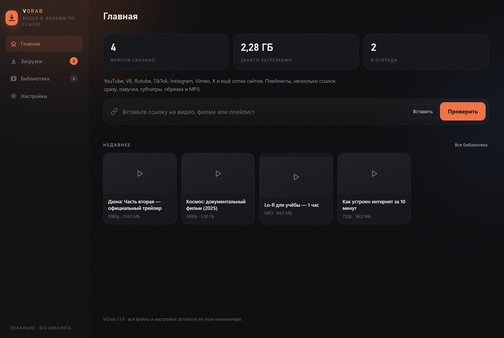
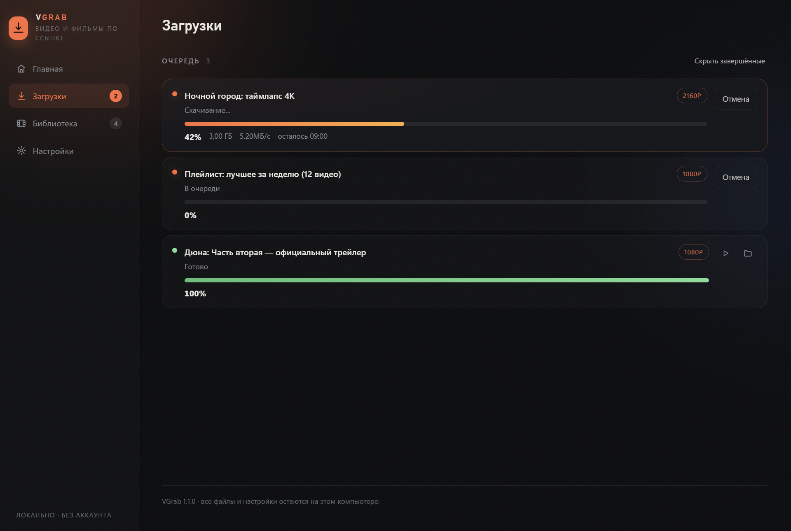

# VGrab — видео и фильмы по ссылке

Бесплатный портативный загрузчик видео и фильмов для Windows. Один exe-файл, без установки, без аккаунта и рекламы. Все файлы и настройки остаются на компьютере пользователя.

[Сайт](https://oleggazeta67-alt.github.io/vgrab/) · [Скачать для Windows](https://github.com/oleggazeta67-alt/vgrab/releases/download/v1.1.0/VGrab.exe) · [Все релизы](https://github.com/oleggazeta67-alt/vgrab/releases)



## Возможности

- Сотни сайтов: YouTube, VK, Rutube, TikTok, Instagram, Vimeo, X и другие через yt-dlp
- Плейлисты и несколько ссылок сразу, последовательная очередь с прогрессом, скоростью и ETA
- Фильмы: выбор озвучки, субтитры отдельным файлом .srt, качество до 4K
- Обрезка по времени, форматы MP4 / WebM / MKV, только звук MP3, видео без звука
- Кабинет: главная со счётчиками, загрузки, библиотека, настройки
- Уведомления о завершении, автообновление движка yt-dlp из приложения
- Приватность: сервер слушает только 127.0.0.1, никакой телеметрии и облаков



## Установка

1. Скачайте `VGrab.exe` из [релиза](https://github.com/oleggazeta67-alt/vgrab/releases/latest).
2. Запустите файл. Установка не нужна, можно носить на флешке.
3. Если Windows показывает предупреждение SmartScreen: «Подробнее», затем «Выполнить в любом случае» (приложение без цифровой подписи).

Внутри уже есть yt-dlp и ffmpeg, ничего докачивать не нужно. Требуется Windows 10/11 (64-bit).

## Границы

Сервисы с DRM-защитой (Кинопоиск, ivi, Okko, Wink, Netflix и подобные) не поддерживаются: VGrab не обходит защиту и работает только с открытыми источниками. Скачивайте только то, на что у вас есть право.

## Сборка из исходников

```bash
npm install
npm run dist
```

Готовый портативный exe появится в папке `release`. Сайт-визитка лежит в `publish/` (деплой) и `site/` (локальная копия с exe).

## Стек

Electron, Node.js, yt-dlp, ffmpeg. Интерфейс: ванильные HTML/CSS/JS, тёмная тема, шрифты Unbounded и Golos Text на сайте.

## Лицензия и права

VGrab распространяется бесплатно. Уважайте авторские права и правила площадок.